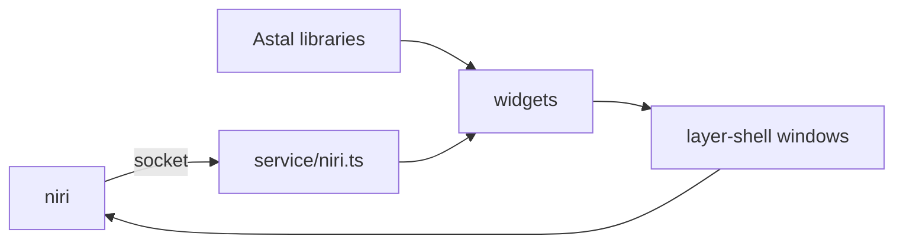

# Architecture

How ags-rubick is built and why. Read it before changing how the parts
fit together. It describes the prototype; most of it is not built yet.

Draft: the owner has not approved it yet.

## Scope

The shell is to replace noctalia, the shell the owner runs now. The
parts, in the order they are built:

1. a launcher for apps, opened with `ags toggle`;
2. the niri service, with workspaces and the keyboard layout on the bar;
3. a control center: sound, Wi-Fi, Bluetooth;
4. an OSD for volume and brightness;
5. a power menu: power off, reboot, suspend, log out;
6. notifications: popups and a history;
7. the wallpaper;
8. the lock screen;
9. a clipboard history.

The launcher comes first: it does not need niri and is of use right
away, next to noctalia. Notifications and the wallpaper come late,
because noctalia has to stop for them: it owns the notification name on
D-Bus and draws its own wallpaper.

## Bird's eye view

The shell is one `gjs` process, the AGS instance `rubick`. Each window is
a GTK4 window on the layer-shell protocol, placed by niri like any other
layer surface. State comes from services: niri over its IPC socket, the
rest from Astal libraries over D-Bus. Widgets bind to the state of a
service and redraw when it changes; they never talk to niri or D-Bus
themselves.

## Code map

- `app.tsx`: starts the app with `app.start()` and creates the windows.
  The bar is made for every monitor in `app.monitors`, so bars come and
  go with the outputs.
- `widget/bar/`: the bar, with start, center and end slots; the clock
  with a calendar.
- `service/niri.ts`: not built yet, see below.
- `style/`: the stylesheet, compiled by AGS with `sass` and given to
  `app.start()`.

## The niri service

Astal has no library for niri, so the shell talks to niri itself, over
the socket in `$NIRI_SOCKET`. The protocol is one JSON value per line.

- One connection stays open. The shell sends `"EventStream"` and reads
  the events line by line with `Gio.DataInputStream`. niri sends the full
  state first, then every change: workspaces, windows, focus, keyboard
  layouts.
- The service is a GObject with properties such as `workspaces`,
  `windows`, `focusedWindow` and `keyboardLayout`. Widgets use it like an
  Astal library: `createBinding(niri, "workspaces")`.
- An action opens a short connection of its own and sends one request,
  such as `{"Action":{"FocusWorkspace":{"reference":{"Id":3}}}}`.

## Invariants

- Only services talk to processes and sockets outside the shell; widgets
  only bind to their state.
- A window name is unique in the instance: a window that exists per
  monitor carries the connector in its name, such as `bar-eDP-1`.
- A missing subsystem is not an error: without niri, a battery or a
  network, the widget that needs it is hidden and the shell runs on.

## Decisions

- **AGS v3 with GTK4.** Layer-shell windows, JSX and the Astal libraries
  in TypeScript, with no build step to run by hand.
- **Our own niri IPC, not AstalNiri or `niri msg`.** The socket protocol
  is small and stable; a service of our own needs no extra package and
  no extra process, and niri pushes changes so nothing polls.
- **The clock reads `GLib.DateTime`.** No `date` process every second.
- **Astal libraries for the parts of the scope.** `libastal-apps` for the
  launcher, `libastal-notifd` for notifications, `libastal-wireplumber`
  for sound, `libastal-network` and `libastal-bluetooth` for the control
  center. Brightness comes from sysfs, and the power menu goes through
  logind and the `Quit` action of the niri service, with no library.
- **The keyboard layout comes from the niri service.** niri sends the
  layouts in its event stream and switches them with an action.
- **The wallpaper is a window of the shell.** A layer-shell window on the
  background layer of each monitor, with a `Gtk.Picture`; no extra
  program.
- **The lock screen is part of the shell.** `Gtk4SessionLock` from
  `gtk4-layer-shell` locks the session over `ext-session-lock-v1`, and
  `libastal-auth` checks the password with PAM. If the shell dies while
  locked, the session stays locked until it runs again: the protocol
  never unlocks on a crash.
- **Clipboard history with `cliphist` and `wl-clipboard`.** GTK sees the
  clipboard only while a shell window has focus, so `wl-paste --watch
  cliphist store` keeps the history on disk; the shell lists it with
  `cliphist list` and copies an entry back with `cliphist decode` and
  `wl-copy`.
- **Notifications need noctalia gone.** Only one process can own the
  notification name on D-Bus, and noctalia holds it while it runs.
- **Type check with `tsc` from the system package.** `typescript` comes
  from pacman, like AGS itself; an npm package would make `npm install`
  replace the links AGS puts in `node_modules/`. The AGS library sources
  fail `tsc`, so `scripts/check.sh` counts only errors in our files.
- **Library defaults first.** A setting is added only when a default
  breaks something.

## Open questions

Proposals the owner has not decided yet:

- None for now.
