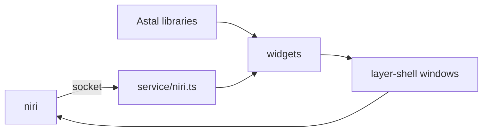

# Architecture

How ags-rubick is built and why. Read it before changing how the parts
fit together. It describes the prototype; most of it is not built yet.

Draft: the owner has not approved it yet.

## Bird's eye view

The shell is one `gjs` process, the AGS instance `rubick`. Each window is
a GTK4 window on the layer-shell protocol, placed by niri like any other
layer surface. State comes from services: niri over its IPC socket, the
rest from Astal libraries over D-Bus. Widgets bind to the state of a
service and redraw when it changes; they never talk to niri or D-Bus
themselves.

## Code map

- `app.tsx`: starts the app with `app.start()` and creates the windows.
  The bar is made for every monitor in `app.monitors`, so bars come and
  go with the outputs.
- `widget/bar/`: the bar, with start, center and end slots; the clock
  with a calendar.
- `service/niri.ts`: not built yet, see below.
- `style/`: the stylesheet, compiled by AGS with `sass` and given to
  `app.start()`.

## The niri service

Astal has no library for niri, so the shell talks to niri itself, over
the socket in `$NIRI_SOCKET`. The protocol is one JSON value per line.

- One connection stays open. The shell sends `"EventStream"` and reads
  the events line by line with `Gio.DataInputStream`. niri sends the full
  state first, then every change: workspaces, windows, focus, keyboard
  layouts.
- The service is a GObject with properties such as `workspaces`,
  `windows`, `focusedWindow` and `keyboardLayout`. Widgets use it like an
  Astal library: `createBinding(niri, "workspaces")`.
- An action opens a short connection of its own and sends one request,
  such as `{"Action":{"FocusWorkspace":{"reference":{"Id":3}}}}`.

## Invariants

- Only services talk to processes and sockets outside the shell; widgets
  only bind to their state.
- A window name is unique in the instance: a window that exists per
  monitor carries the connector in its name, such as `bar-eDP-1`.
- A missing subsystem is not an error: without niri, a battery or a
  network, the widget that needs it is hidden and the shell runs on.

## Decisions

- **AGS v3 with GTK4.** Layer-shell windows, JSX and the Astal libraries
  in TypeScript, with no build step to run by hand.
- **Our own niri IPC, not AstalNiri or `niri msg`.** The socket protocol
  is small and stable; a service of our own needs no extra package and
  no extra process, and niri pushes changes so nothing polls.
- **The clock reads `GLib.DateTime`.** No `date` process every second.
- **Library defaults first.** A setting is added only when a default
  breaks something.

## Open questions

Proposals the owner has not decided yet:

- A type check: `tsc --noEmit` needs `typescript`, which is not
  installed. The library sources that AGS ships fail it, so the check
  would look at our files only.
- What the shell has beyond the bar: a launcher, notifications, an OSD,
  a power menu.
